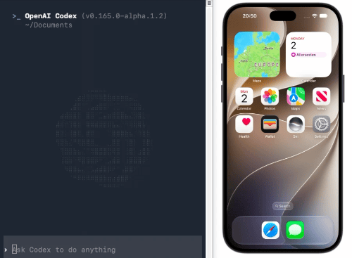

# iSimBot-MCP

**Let your AI agent see and control your iOS Simulator.**

Tap, swipe, type, capture and more — through Claude Code, Codex, or any MCP client.



## Quick Start

Requires Homebrew, Apple Silicon, macOS 15+, and Xcode 26+ with an iOS simulator runtime.

```bash
brew install wei0121/tap/isimbot-mcp
isimbot setup
```

Choose **Claude Code** or **Codex**, then restart the client. Try:

> List my simulators, connect to iPhone 17, and take a screenshot.

- [Installation](doc/installation.md)

- [Usage](doc/usage.md)

- [Roadmap](doc/roadmap.md)

- [Contribute](doc/contribute.md)

## Source Code

This repository contains the full TypeScript implementation of the MCP server.
Homebrew is only the distribution method.

- [Server entry point](src/index.ts)
- [MCP server and request handlers](src/mcp/server.ts)
- [Tool registry](src/mcp/registry.ts)
- [Simulator operations](src/operation/)

Build from source with Node.js 20.9+:

```bash
npm ci
npm run build
```

Actual simulator operations require macOS, Xcode, and IDB.

MIT — see [LICENSE](LICENSE).
